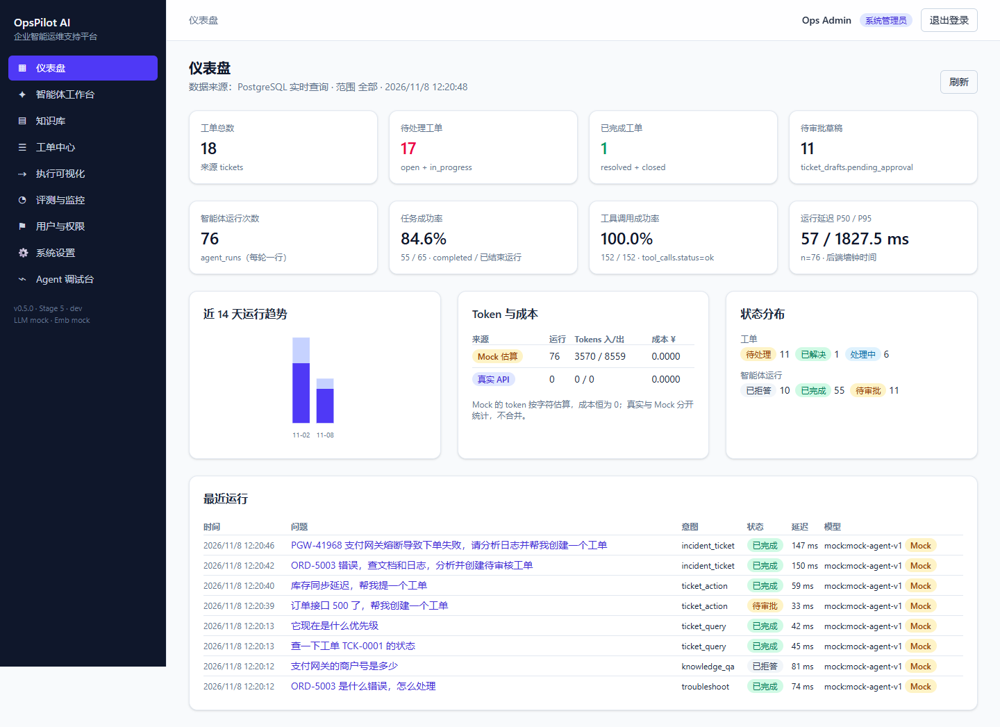

# OpsPilot AI

> Personal portfolio project: an AI support agent that retrieves docs, queries logs via MCP, proposes cited answers, and creates **ticket drafts that only land after human approval**.

**Version: `v1.0.0-rc1`** · Default **Mock** mode (offline, free). Not a claim of production deployment scale or revenue.



## 1. Introduction
OpsPilot wires RAG + diagnostic tools + approval gates into a recoverable LangGraph workflow, with a React admin console, evals, observability, and local Compose delivery.

## 2. Problem
Support engineers juggle runbooks, logs, and tickets. This project shows a controlled pipeline that stays auditable and refuse-aware, without letting the model write tickets or read restricted KBs.

## 3. Features
Enterprise KB RAG with ACL · LangGraph agent + MCP tools + SSE · three-role web UI · mock/local/paid guards · pytest / vitest / Edge e2e · frozen agent eval sets.

## 4. Architecture
See mermaid in [README.md](README.md) and [docs/diagrams/architecture.mmd](docs/diagrams/architecture.mmd).

## 5. Stack
FastAPI, SQLAlchemy, PostgreSQL/pgvector, LangGraph, MCP SDK, React 19, Vite, Docker Compose, Playwright.

## 6. Agent workflow
Guard → classify → MCP tools → evidence → answer/citations → optional interrupt for ticket approval → resume. Details: `backend/src/opspilot/agent/`.

## 7. RAG strategy
Vector / keyword / RRF hybrid / rerank; per-model indexes; ACL prefilter. **Mock hybrid Recall@5 = 0.946** on 55-case `retrieval_zh` (see `docs/reports/STAGE2_5_TABLES.md`).

## 8. MCP
Three stdio servers (knowledge, ticket, diagnostics) with signed caller tokens and DB audit (`mcp_tool_audit`).

## 9. Human approval
Draft creation interrupts the graph; only admins approve; Ticket MCP creates the real ticket afterward.

## 10. Eval results (traceable)
| Suite | Metric | Source |
|---|---|---|
| Agent v1 (45) Mock | Task success **100%** | `evals/results/20261109T033115Z_stage6_baseline_v1_mock.json` |
| Agent v2 final_test (31) | **87.1%** | `..._stage6_v2_final_mock.json` |
| Agent v2 all (103) | **73.8%** | `..._stage6_v2_all_mock.json` |

Mock scores measure plumbing, not LLM reasoning. Paid Qwen comparison is planned but not run by default.

## 11. Screenshots
Under `docs/assets/stage5/` and `docs/assets/stage6/`.

## 12. Quick start
```bash
cp .env.example .env   # set JWT + seed passwords; keep providers=mock
docker compose --env-file .env -f infra/docker-compose.yml up -d --build
uv sync && uv run python scripts/seed_demo.py && uv run python scripts/load_demo_corpus.py
# open http://localhost:5173
```

## 13. Configuration
See `.env.example`. Ports bind to `127.0.0.1`. Never `bash -x` scripts that source `.env`.

## 14. Tests
`uv run pytest -q` · frontend lint/tsc/vitest/build (Node ≥22) · `scripts/e2e_windows.ps1` · `scripts/run_ci_local.sh`.

## 15. FAQ
Port conflicts → change `.env`. Weak answers → Mock extractor. Cannot self-approve tickets → by design.

## 16. Limits
No token streaming; in-process spans lost on restart; no K8s/Redis/Grafana stack; no demo video file (recording plan only).

## License
MIT — see [LICENSE](LICENSE) and [docs/LICENSE_DECISION.md](docs/LICENSE_DECISION.md).
