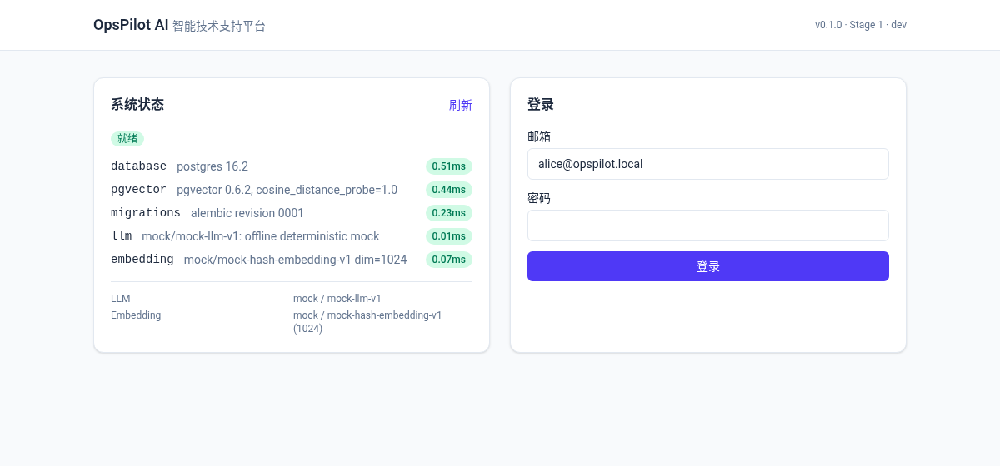

# OpsPilot AI

> Production-oriented AI Support & Ticket Resolution Platform
> 面向软件企业技术支持 / 研发 / 客服团队的智能技术支持 Agent 平台：查文档、查日志、给出有出处的故障建议、生成待审工单，人工审批后才落库。

**当前进度：第一阶段（基础设施）已完成** —— 详见 [docs/PROGRESS.md](docs/PROGRESS.md) 与 [阶段 1 报告](docs/reports/STAGE1_REPORT.md)。
Agent、RAG、MCP、审批等核心能力尚未实现，按阶段推进，README 只写已经验证过的内容。



## 文档
- [PRD 需求说明](docs/PRD.md) · [架构说明](docs/ARCHITECTURE.md) · [数据库设计](docs/DATABASE.md) · [API 设计](docs/API.md)
- [阶段进度](docs/PROGRESS.md) · [阶段 1 报告](docs/reports/STAGE1_REPORT.md)

## 技术栈
FastAPI · Pydantic v2 · SQLAlchemy 2 · Alembic · PostgreSQL + pgvector · PyJWT + Argon2 · structlog ·
（后续阶段）LangGraph · LangChain · MCP Python SDK · Qwen（OpenAI 兼容）· React 19 + TypeScript + Vite + Tailwind v4。
版本与选型依据见 [ARCHITECTURE.md §5](docs/ARCHITECTURE.md)。

## 快速开始（Windows + WSL2）

### 方式 A：Docker Compose（推荐）
在 WSL2 终端里（Docker Desktop 开启 WSL 集成，或 WSL 内装 Docker Engine）：
```bash
cp .env.example .env              # 默认 Mock 模式，不需要任何 API Key
docker compose -f infra/docker-compose.yml up -d --build
docker compose -f infra/docker-compose.yml exec backend uv run --no-sync python scripts/seed_demo.py
```
- 前端 http://localhost:5173 ，后端 http://localhost:8000/docs
- 后端容器启动时自动执行 `alembic upgrade head`
> 说明：阶段 1 的开发沙箱没有 Docker，Compose 文件已做语法校验但**尚未实际 `up` 过**；实际验证用的是方式 B。第六阶段会在 WSL2 中完整验证 Compose。

### 方式 B：本地进程（无 Docker 也可）
前置：[uv](https://docs.astral.sh/uv/)、Node 22 LTS、一个带 pgvector 的 PostgreSQL（可用 Compose 只起 `postgres` 服务，或 `scripts/local_pg.sh start` 用 PyPI 上的 pgserver 便携版）。
```bash
cp .env.example .env
uv sync                                   # Python 3.11 依赖（uv.lock 锁定）
scripts/local_pg.sh start                 # 或: docker compose -f infra/docker-compose.yml up -d postgres
uv run alembic upgrade head
uv run python scripts/seed_demo.py        # 演示账号，密码来自 .env
make dev-backend                          # :8000
cd frontend && npm ci && npm run dev      # :5173（Vite 代理 /api 与 /health 到后端）
```

演示账号（仅本地）：`admin@opspilot.local`（管理员）、`alice@opspilot.local`、`bob@opspilot.local`（普通用户），密码见 `.env.example` 的 `OPSPILOT_SEED_*`。

## Mock 模式与真实模型
默认 `OPSPILOT_LLM_PROVIDER=mock`、`OPSPILOT_EMBEDDING_PROVIDER=mock`：离线、确定性、零费用，测试与 CI 都用它。
切换 Qwen：把两项改为 `openai_compatible`，并在 `.env` 中自行填写 `OPSPILOT_LLM_API_KEY`（不要提交）。阶段 1 中没有任何代码路径会调用真实模型。

## 常用命令
| 命令 | 作用 |
|---|---|
| `make test` | 全部 pytest（单元 + 连真实 PostgreSQL 的集成测试，`OPSPILOT_REQUIRE_DB=1` 时数据库不可用即失败） |
| `make test-unit` | 只跑单元测试 |
| `make lint` / `make fmt` | Ruff 检查 / 格式化 |
| `make fe-build` / `make fe-test` | 前端构建 / Vitest |
| `make check` | 以上全部 |

集成测试使用 `OPSPILOT_TEST_DATABASE_URL`（默认 `opspilot_test` 库），每次会 `downgrade base → upgrade head`，**请勿指向有数据的库**。

## 已实现（阶段 1）
- FastAPI 应用工厂、pydantic-settings 配置（带安全校验）、JSON 结构化日志 + request_id + 敏感字段打码、统一错误格式
- Alembic 初始迁移：16 张表（含 `vector(1024)` + HNSW、`tsvector` 生成列 + GIN、审批相关唯一约束）
- `/health/live`、`/health/ready`（DB / pgvector / 迁移 / LLM / Embedding 分项检查，失败 503）
- LLM / Embedding Provider 接口：MockLLM、MockEmbedding（特征哈希）、OpenAI 兼容（Qwen）实现
- JWT 登录、`/me`、`user/admin` 角色依赖，演示数据种子脚本（幂等）
- 最小 React 前端：系统状态 + 登录，连接真实后端
- GitHub Actions 工作流、Dockerfile、Compose（未在沙箱中运行，见上）

## License
MIT
