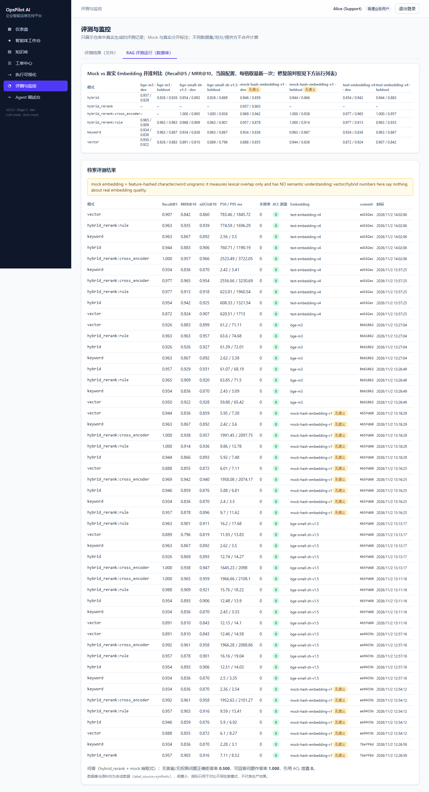

# OpsPilot AI

> Production-oriented AI Support & Ticket Resolution Platform
> 面向软件企业技术支持 / 研发 / 客服团队的智能技术支持 Agent 平台：查文档、查日志、给出有出处的故障建议、生成待审工单，人工审批后才落库。

**当前进度：阶段 2.5（真实免费本地 Embedding + 混合检索评测）已完成，在 WSL2 + Docker Compose 上实测（tag `stage-2.5`）** —— 详见 [docs/PROGRESS.md](docs/PROGRESS.md)、[阶段 2.5 报告](docs/reports/STAGE2_5_REPORT.md)、[阶段 2.5 评测](docs/reports/STAGE2_5_EVAL.md)、[阶段 3 设计](docs/STAGE3_DESIGN.md)。
Agent、MCP、工单审批尚未实现（第三、四阶段）。README 只写已经验证过的内容。

> ⚠️ 默认 **Mock 模式**：mock embedding 是特征哈希的字/词袋向量，**没有语义理解**；mock 回答器是**抽取式**的（摘录原文 + 引用），**没有调用大模型**。界面和接口都明确标注了这一点。阶段 2.5 起可选**免费本地 CPU 模型**（bge-small-zh-v1.5 / bge-m3 embedding、bge-reranker-base 重排），已实测；真实 DashScope / Qwen 付费路径有多重守卫，**尚未运行**（[方案待批准](docs/STAGE2_5_PAID_EMBED_PLAN.md)）。



## 文档
- [PRD 需求说明](docs/PRD.md) · [架构说明](docs/ARCHITECTURE.md) · [数据库设计](docs/DATABASE.md) · [API 设计](docs/API.md)
- [阶段进度](docs/PROGRESS.md) · [阶段 1 报告](docs/reports/STAGE1_REPORT.md) · [阶段 2 设计](docs/STAGE2_DESIGN.md) · [阶段 2 报告](docs/reports/STAGE2_REPORT.md) · [检索评测报告](docs/reports/STAGE2_EVAL.md)
- [阶段 2.5 报告](docs/reports/STAGE2_5_REPORT.md) · [阶段 2.5 评测](docs/reports/STAGE2_5_EVAL.md) · [评测汇总表](docs/reports/STAGE2_5_TABLES.md) · [付费 Embedding 对照方案（未执行）](docs/STAGE2_5_PAID_EMBED_PLAN.md) · [阶段 3 设计](docs/STAGE3_DESIGN.md)
- [RAG 流程 Notebook（中文，含输出）](notebooks/rag_walkthrough.ipynb) · [真实 Embedding / 混合检索 Notebook（中文，含输出）](notebooks/real_embedding_hybrid.ipynb)

## 技术栈
FastAPI · Pydantic v2 · SQLAlchemy 2 · Alembic · PostgreSQL + pgvector（HNSW）+ 全文检索（GIN）· jieba · pypdf · LangChain text-splitters · PyJWT + Argon2 · structlog · React 19 + TypeScript + Vite + Tailwind v4 ·
（后续阶段）LangGraph · MCP Python SDK · Qwen（OpenAI 兼容）。
版本与选型依据见 [ARCHITECTURE.md §5](docs/ARCHITECTURE.md)。

## 快速开始（Windows + WSL2，从零开始）

前置（均为一次性安装，本项目不需要 sudo）：WSL2 Ubuntu、Docker（WSL 内 Docker Engine 或 Docker Desktop 的 WSL 集成）、Git、[uv](https://docs.astral.sh/uv/)。宿主机不需要 Node 和 Python（容器里自带；跑 pytest 时 uv 会自动下载 Python 3.11）。

```bash
# 1) 获取代码（任选：git clone / 解压发布包 / git bundle）
cd ~/projects/opspilot-ai

# 2) 配置：默认 Mock 模式，不需要任何 API Key
cp .env.example .env
#   - 端口冲突时改 .env 里的 OPSPILOT_PG_PORT / OPSPILOT_BACKEND_PORT / OPSPILOT_FRONTEND_PORT，
#     同时把 OPSPILOT_DATABASE_URL / OPSPILOT_TEST_DATABASE_URL 的端口改成与 OPSPILOT_PG_PORT 一致
#   - 建议生成随机 JWT 密钥：
sed -i "s/^OPSPILOT_JWT_SECRET=.*/OPSPILOT_JWT_SECRET=$(python3 -c 'import secrets;print(secrets.token_urlsafe(48))')/" .env

# 3) 启动（postgres+pgvector → backend 自动 alembic upgrade head → frontend）
docker compose --env-file .env -f infra/docker-compose.yml up -d --build
docker compose --env-file .env -f infra/docker-compose.yml ps

# 4) 演示账号（幂等，可重复执行）
docker compose --env-file .env -f infra/docker-compose.yml exec backend python scripts/seed_demo.py

# 4b) 阶段 2：导入合成语料（13 篇 MD/TXT/PDF，3 个知识库；幂等，重复执行显示 duplicate）
docker compose --env-file .env -f infra/docker-compose.yml exec backend python scripts/load_demo_corpus.py
#     四种检索模式评测（mock，免费）：结果写入 evals/results/ 和 eval_runs 表，前端「评测」页可查看
uv run python evals/run_retrieval_eval.py

# 5) 检查
curl -s http://localhost:8000/health/ready     # 端口按 .env 的 OPSPILOT_BACKEND_PORT
#    浏览器打开 http://localhost:5173 （Windows 浏览器可直接访问 WSL 的 localhost 端口）

# 6) 测试（在宿主 WSL 中，连接 compose 里的 opspilot_test 库）
uv sync --frozen
OPSPILOT_REQUIRE_DB=1 uv run pytest -v
uv run ruff check . && uv run ruff format --check .
docker compose --env-file .env -f infra/docker-compose.yml exec frontend npm test
docker compose --env-file .env -f infra/docker-compose.yml exec frontend npm run build

# 7) Notebook（中文 RAG 流程演示，执行后保留输出）
make notebook
```

> 作者机器（Teddy 的 WSL2）上 8000/8010 已被其他项目占用，实际使用 `OPSPILOT_PG_PORT=5433`、`OPSPILOT_BACKEND_PORT=8020`、`OPSPILOT_FRONTEND_PORT=5173`，下文 `8000` 请按你的 `.env` 替换。
>
> `--env-file .env` 不能省略：compose 文件位于 `infra/`，默认只会读取 `infra/.env` 来替换端口变量。

| 服务 | 默认地址（全部只绑定 127.0.0.1） | 变量 |
|---|---|---|
| 前端（Vite，代理 `/api`、`/health` 到后端） | http://localhost:5173 | `OPSPILOT_FRONTEND_PORT` |
| 后端 API / Swagger | http://localhost:8000/docs | `OPSPILOT_BACKEND_PORT` |
| PostgreSQL 17 + pgvector 0.8.7 | 127.0.0.1:5432（库 `opspilot`，测试库 `opspilot_test`） | `OPSPILOT_PG_PORT` |

停止：`docker compose --env-file .env -f infra/docker-compose.yml down`（数据保存在卷 `opspilot_pgdata`，上传的原始文件在卷 `opspilot_uploads`；**加 `-v` 会删除数据**）。

### 不用 Docker 的本地进程方式
```bash
scripts/local_pg.sh start                 # PyPI pgserver 便携版 PostgreSQL 16 + pgvector 0.6（无需 sudo）
uv sync && uv run alembic upgrade head && uv run python scripts/seed_demo.py
make dev-backend                          # :8000
cd frontend && npm ci && npm run dev      # :5173，需要 Node 22
```

### 演示账号
`admin@opspilot.local`（管理员）、`alice@opspilot.local`、`bob@opspilot.local`（普通用户）。密码是 `.env` 中的 `OPSPILOT_SEED_ADMIN_PASSWORD` / `OPSPILOT_SEED_USER_PASSWORD`（`.env.example` 里的默认值仅供本地演示）。权限矩阵（阶段 2 的 ACL 演示与评测都基于它）：

| 知识库 | 可见性 | admin | alice | bob |
|---|---|---|---|---|
| `order-platform` 订单平台技术文档 | restricted | 读写 | 只读（授权） | ✗ |
| `public-faq` 公共 FAQ | public | 读写 | 只读 | 只读 |
| `hr-confidential` 人力资源保密文档 | restricted（无授权） | 读写 | ✗ | ✗ |

## Mock 模式与真实模型
默认 `OPSPILOT_LLM_PROVIDER=mock`、`OPSPILOT_EMBEDDING_PROVIDER=mock`：离线、确定性、零费用，测试与 CI 都用它。
切换 Qwen / DashScope：把两项改为 `openai_compatible`，在 `.env` 中自行填写 `OPSPILOT_LLM_API_KEY`（不要提交），**并且**设置 `OPSPILOT_ALLOW_PAID_API=true`——缺少这个显式开关时，配置加载会直接报错，防止误调用付费接口。
**免费本地模型（阶段 2.5，CPU，不需要 Key）**：`uv sync --group local-embed`（装 torch CPU 版约 1 GB；注意 `--all-groups` 也会装它），设置 `OPSPILOT_EMBEDDING_PROVIDER=local`（默认 bge-small-zh-v1.5，固定 revision），可选 `OPSPILOT_RERANKER=cross_encoder`（约 2 秒/查询）。首次下载模型后可设 `HF_HUB_OFFLINE=1`。每个 embedding 模型有独立索引，切换模型不会删除或混用旧向量，需对文档「重建索引」。
本地评测：`uv run --group local-embed python evals/run_retrieval_eval.py --embedding local --dataset dev|heldout --rerankers rule,cross_encoder`。
**付费路径**（`--embedding dashscope --i-understand-this-costs-money`）另需 `OPSPILOT_ALLOW_PAID_API=true`、`OPSPILOT_PAID_APPROVAL_ID`、`OPSPILOT_PAID_BUDGET_CNY`，超出预算在发请求前拒绝；**尚未运行**。

## 常用命令
| 命令 | 作用 |
|---|---|
| `make test` | 全部 pytest（单元 + 连真实 PostgreSQL 的集成测试，`OPSPILOT_REQUIRE_DB=1` 时数据库不可用即失败） |
| `make test-unit` | 只跑单元测试 |
| `make lint` / `make fmt` | Ruff 检查 / 格式化 |
| `make fe-build` / `make fe-test` | 前端构建 / Vitest |
| `make check` | 以上全部 |
| `make e2e` | 真实浏览器登录 E2E（Playwright + 无头 Chromium，需先启动整套服务，密码从 `.env` 读取） |
| `make e2e-rag` | 真实浏览器 RAG E2E：知识库 → 分块查看 → 四模式检索 → 问答引用 → 评测页 |
| `make corpus` / `make corpus-docker` | 导入合成语料（宿主 / 容器内） |
| `make eval` | 四种检索模式评测（mock embedding） |
| `make notebook` | 重新生成并执行 `notebooks/rag_walkthrough.ipynb` |
| `uv run python scripts/build_stage25_notebook.py` + nbconvert | 生成并执行 `notebooks/real_embedding_hybrid.ipynb`（需 local-embed 组） |

WSL 内的 Chromium 缺系统库（`libasound2`，需要 sudo），所以作者机器上的 E2E 用 Windows 的无头 Edge 跑：`powershell -File scripts\e2e_windows.ps1 -Shots <截图目录>`。

集成测试使用 `OPSPILOT_TEST_DATABASE_URL`（默认 `opspilot_test` 库），每次会 `downgrade base → upgrade head`，**请勿指向有数据的库**。

## 已实现（阶段 2.5）
- 免费本地 CPU embedding（bge-small-zh-v1.5 / bge-m3）与真实 cross-encoder 重排，固定 revision；多模型隔离向量索引（每模型部分 HNSW），mock 向量保留
- 冻结 held-out（37 条）+ dev（55 条）真实评测，Mock 基线并排；前端评测页矩阵与逐条失败分类
- 修复：改写题误拒、近话题误答（anchor 检查）、重排丢失 multi_doc（RRF 融合）、cross-encoder 双 sigmoid、真实 token 计数；pgvector iterative scan（relaxed_order）
- 注入防御输出策略层（链接白名单等）+ 服从注入的假 LLM 测试；embedding 故障自动降级关键词
- 统一模型调用层 ModelGateway：调用计数、token、成本、预算硬上限、账本、密钥脱敏；付费默认关闭

## 已实现（阶段 2：企业知识库 RAG）
- 上传 PDF / Markdown / TXT：白名单、大小上限、魔数与扩展名一致性、二进制伪装检测、UTF-8/GB18030 解码；解析错误带错误码与中文说明
- PDF 逐页解析（页码进入引用）、清洗（逐字空格折叠、视觉换行合并）；Markdown 标题感知分块（`heading_path`）+ LangChain `RecursiveCharacterTextSplitter`（中文标点优先），偏移量精确
- 内容 SHA-256 去重；同名上传 = 新版本，旧版本 `superseded`、旧分块在同一事务内替换；失败版本不影响旧版本服务；重建索引 / 删除
- 检索统一接口：向量（pgvector HNSW）、关键词（jieba 预分词 + PG 全文检索，错误码归一化）、混合 RRF（k=60）、混合 + 重排（可插拔 Reranker），返回每种方法的分数与排名、各阶段耗时
- **ACL 在 SQL WHERE 中、排序之前生效**；不同 embedding 模型的向量不混算
- 带引用的问答：引用真实 chunk id / 文档 / 页码；证据不足时固定回答「证据不足」；检索内容视为不可信（注入检测、剔除、`<untrusted_document>` 隔离、引用校验）
- 评测：55 条中文问题（6 类，合成数据，标注来源如实说明），Recall@5 / MRR@10 / nDCG@10 / P50 / P95 / 失败率 / ACL 泄露 / 拒答率，JSON + MD + 数据库
- 前端：知识库管理（上传、状态、版本、删除、重建）、分块查看器、检索调试（四模式并排）、问答面板（引用 + mock 标注）、评测结果页
- 中文 Notebook：解析 → 分块 → 分词 → 向量化 → 入库 → 各检索器 → 手算 RRF → 重排 → 回答 → 指标

## 已实现（阶段 1）
- FastAPI 应用工厂、pydantic-settings 配置（带安全校验）、JSON 结构化日志 + request_id + 敏感字段打码、统一错误格式
- Alembic 初始迁移：16 张表（含 `vector(1024)` + HNSW、`tsvector` 生成列 + GIN、审批相关唯一约束）
- `/health/live`、`/health/ready`（DB / pgvector / 迁移 / LLM / Embedding 分项检查，失败 503）
- LLM / Embedding Provider 接口：MockLLM、MockEmbedding（特征哈希）、OpenAI 兼容（Qwen）实现
- JWT 登录、`/me`、`user/admin` 角色依赖，演示数据种子脚本（幂等）
- 最小 React 前端：系统状态 + 登录，连接真实后端
- Dockerfile + Docker Compose：已在 WSL2（Docker 29.9.2 / Compose v5.6.1）实际启动并验证
- GitHub Actions 工作流（尚未在 GitHub 上运行，仓库未推送）

## License
MIT
