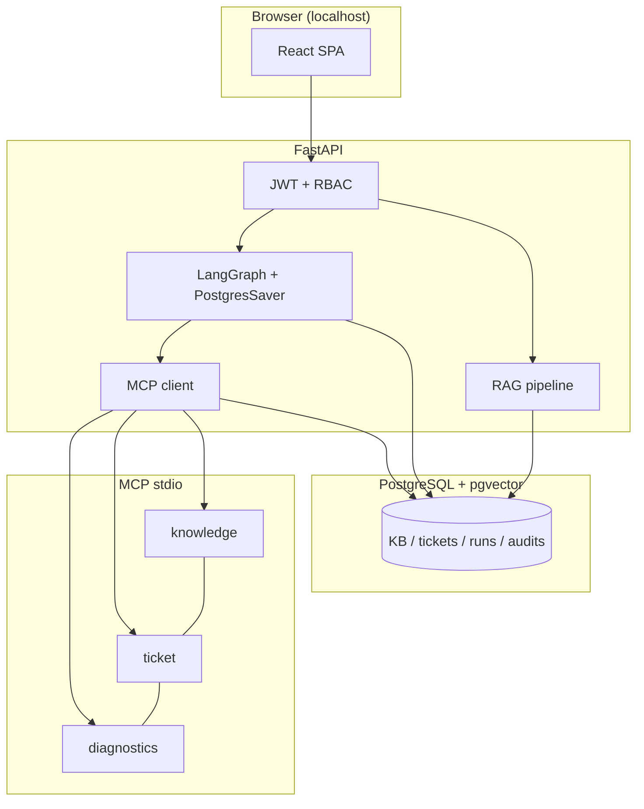
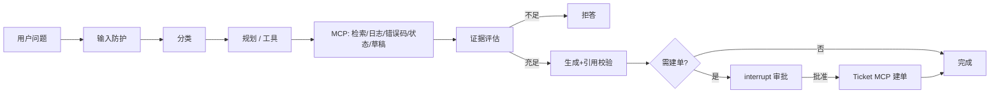
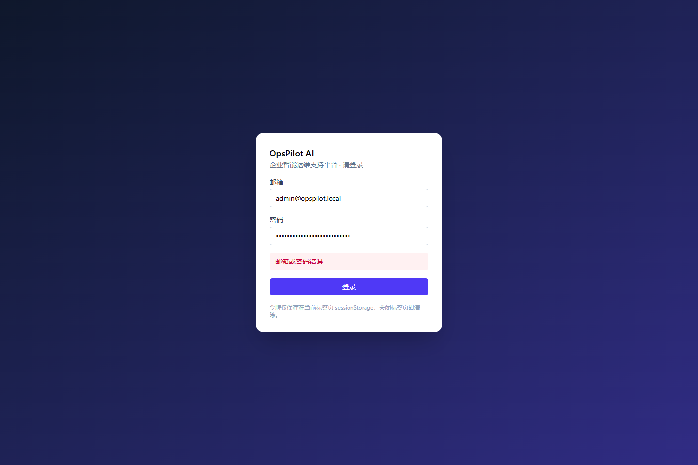
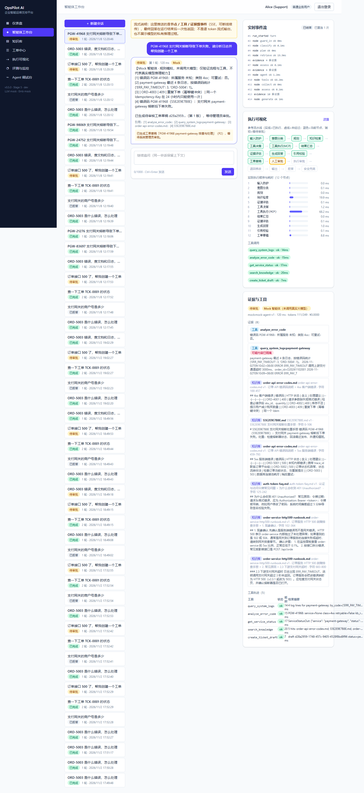
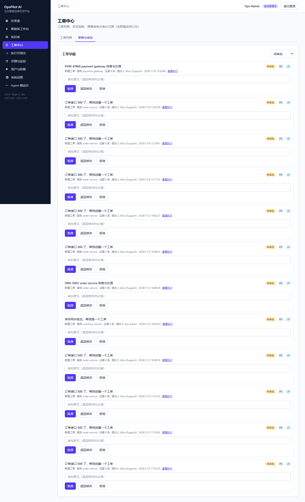
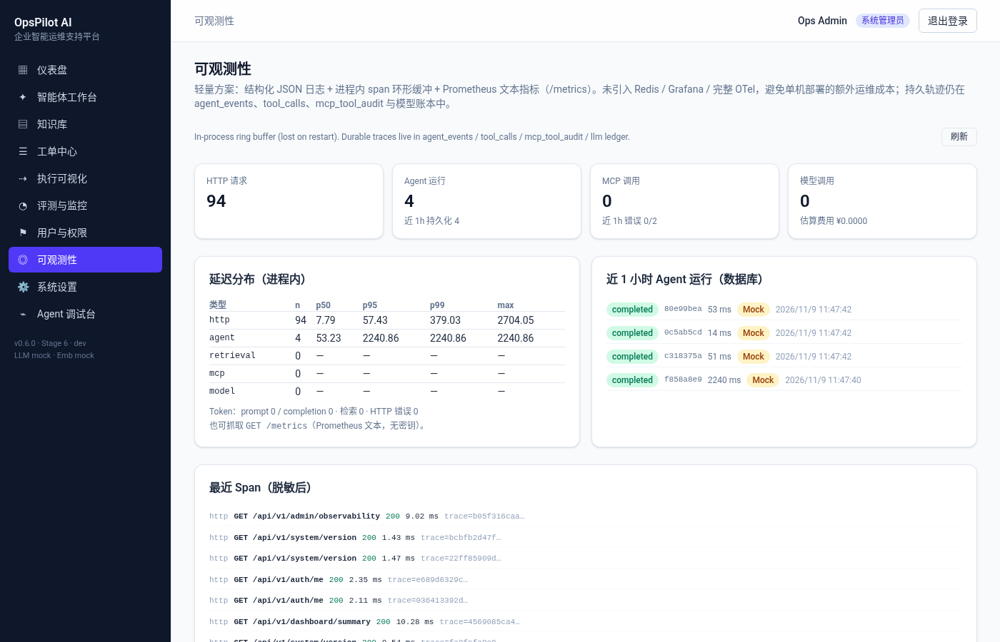
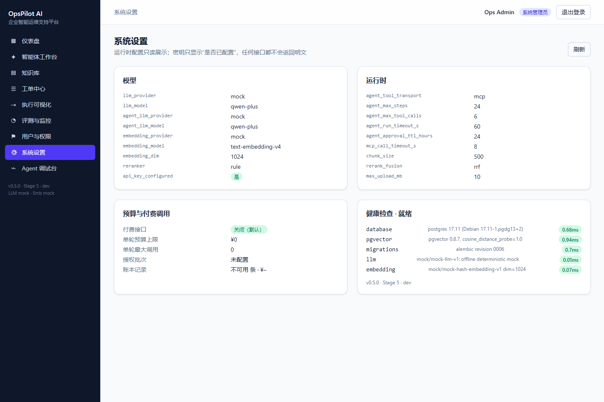

# OpsPilot AI

> 面向软件企业技术支持 / 研发的**智能运维支持 Agent**（个人作品集项目）：查知识库、查日志、给出有出处的故障建议、生成待审工单，**人工审批后才落库**。

**当前版本：`v1.0.0-rc1`（Stage 7 交付候选）** · 默认 **Mock 模式**（离线、确定性、零费用）  
进度与验收报告：[docs/PROGRESS.md](docs/PROGRESS.md) · [STAGE7_REPORT](docs/reports/STAGE7_REPORT.md)

> 本仓库是**个人工程作品**，用于学习与求职展示。未声称真实企业生产部署规模、用户量或收入。付费模型路径默认关闭。


## 1. 项目介绍
OpsPilot AI 把「文档问答 + 诊断工具 + 工单草稿 + 人工审批」串成一条可恢复的 Agent 流水线，并补齐 Web 管理界面、评测、可观测与本地工程化交付。

## 2. 实际解决的业务问题
技术支持同学常要在多份文档、日志和错误码之间跳转，再手工开单。本项目演示如何用受控工具与审批门禁，把「检索 → 诊断 → 草稿 → 审批 → 建单」变成可审计、可评测的流程，同时避免模型直接落库或越权读保密知识库。

## 3. 核心功能
- 企业知识库 RAG（上传、版本、ACL、向量/关键词/RRF/重排、带引用问答）
- LangGraph Agent（多节点、MCP 工具、拒答、审批 interrupt、Postgres 检查点恢复、SSE 事件流）
- 三角色 Web 平台：仪表盘、工作台、知识库与授权、工单中心、执行可视化、评测、用户与设置、可观测性
- Mock / 本地免费模型 / 付费 Qwen 多重守卫（付费需显式开关与预算）
- 自动化测试、Edge E2E、Agent/RAG 评测集、本地 Compose 开发与生产前端

## 4. 整体架构图

源文件：[docs/diagrams/architecture.mmd](docs/diagrams/architecture.mmd) · 阶段图：[docs/diagrams/](docs/diagrams/)

## 5. 技术栈
FastAPI · Pydantic v2 · SQLAlchemy 2 · Alembic · PostgreSQL + pgvector · jieba · LangGraph · MCP Python SDK · structlog · React 19 + TypeScript + Vite + Tailwind · Docker Compose · Playwright E2E

## 6. Agent 工作流图

实现：`backend/src/opspilot/agent/` · 说明：[docs/AGENT_STATE.md](docs/AGENT_STATE.md)

## 7. RAG 检索策略
- 解析分块 → 按 embedding 模型隔离索引 → `vector` / `keyword` / `hybrid`(RRF) / `hybrid_rerank`
- ACL 预过滤；问答带引用与策略检查（注入、密钥形态、动作宣称等）
- **实测（Mock embedding，dev 55 条，来源 `docs/reports/STAGE2_5_TABLES.md`）**：hybrid Recall@5 **0.946**；hybrid+rule rerank **0.957**；cross-encoder 可到 **0.969** 但 P95≈2s
- Mock embedding **无语义理解**，界面会明确标注

## 8. MCP 工具接入
三个 stdio Server（`opspilot-knowledge` / `opspilot-ticket` / `opspilot-diagnostics`）。调用经短时签名令牌与 ACL；审计写入 `mcp_tool_audit`。详见 [ADR-004](docs/adr/ADR-004-stage4-mcp.md)。

## 9. 人工审批机制
创建工单草稿时图进入 `awaiting_approval`（LangGraph interrupt + PostgresSaver）。仅 admin 可批准/驳回/退回；普通用户调用审批接口返回 403。批准后由 Ticket MCP 建正式工单并写事件审计。

## 10. 系统评测结果（可追溯）
| 评测 | 数据集 | 关键指标 | 来源文件 |
|---|---|---|---|
| Agent Mock baseline | `agent_eval_v1` 45 条 | Task success **100%** | `evals/results/20261109T033115Z_stage6_baseline_v1_mock.json` |
| Agent Mock 冻结集 | `agent_eval_v2` final_test 31 条（SHA 见 `evals/agent/FROZEN_v2.sha256`） | Task success **87.1%** | `..._stage6_v2_final_mock.json` |
| Agent Mock 全量 | v2 103 条 | Task success **73.8%**（合成期望偏严，已如实记录） | `..._stage6_v2_all_mock.json` |
| RAG Mock | `retrieval_zh` 55 | hybrid R@5 **0.946** | `docs/reports/STAGE2_5_TABLES.md` |

> Mock Agent 指标衡量流程/权限/工具/审批，**不能**当作真实大模型推理能力证据。真实 Qwen 对照有预算计划，**默认未执行**。

## 11. 产品截图
| 页面 | 截图 |
|---|---|
| 登录 |  |
| 仪表盘 |  |
| 工作台（SSE） |  |
| 工单 / 审批 |  |
| 可观测性 |  |
| 设置（密钥不落明文） |  |

## 12. 快速启动（Windows + WSL2）
```bash
# 1) 获取代码后进入仓库
cp .env.example .env
# 编辑 .env：改 JWT、种子密码；保持 OPSPILOT_*_PROVIDER=mock

# 2) 启动
docker compose --env-file .env -f infra/docker-compose.yml up -d --build

# 3) 种子与语料（幂等）
uv sync
uv run python scripts/seed_demo.py
uv run python scripts/load_demo_corpus.py

# 4) 浏览器打开 http://localhost:5173
```
生产前端（本机）：`docker compose --env-file .env -f infra/docker-compose.yml -f infra/docker-compose.prod.yml --profile prod up -d --build frontend_prod` → http://localhost:5180

## 13. 环境变量配置
见 [.env.example](.env.example)。要点：
- 所有 Compose 端口默认绑 `127.0.0.1`
- `OPSPILOT_ALLOW_PAID_API` 默认 false；付费还需 approval id / 预算 / max calls
- **切勿**对会 `source .env` 的脚本使用 `bash -x`
- 测试库名必须以 `_test` / `_eval` 结尾，评测 `--prepare` 才会重置

## 14. 自动化测试
```bash
uv run ruff check . && uv run ruff format --check .
uv run pytest -q                          # Stage 6：269 passed, 1 skipped（当时环境）
cd frontend && npm ci && npm run lint && npx tsc --noEmit -p . && npx vitest run && npm run build
# Windows Edge 全量 E2E
powershell -ExecutionPolicy Bypass -File scripts/e2e_windows.ps1 -Shots C:\tmp\shots -ProdUrl http://localhost:5180
# 本地 CI 脚本
bash scripts/run_ci_local.sh
```
前端 vitest 需要 **Node ≥ 22**（Compose frontend 镜像满足；部分宿主 Node 20 会失败）。

## 15. 常见问题
- **端口冲突**：改 `.env` 中 `OPSPILOT_PG_PORT` / `BACKEND` / `FRONTEND`，并同步 DATABASE_URL 端口。
- **为什么答案很「抽」**：Mock 是抽取式，不是大模型生成。
- **为什么不能自己批准工单**：设计如此（RBAC）；请用 admin。
- **能否公开推送到 GitHub**：需 Teddy 单独授权（Stage 7 默认不推送）。

## 16. 已知限制
- 默认 Mock：无真实语义推理；Agent 扩展集成功率受合成期望影响
- SSE 为节点/事件级，非逐 token
- 可观测 span 在进程内环形缓冲，重启丢失（持久轨迹在 DB）
- 未引入 K8s / Redis / 完整 Grafana 栈（见 [ADR-005](docs/adr/ADR-005-stage6-engineering.md)）
- 不包含演示视频文件；仅提供[录制方案](docs/demo/DEMO_SCRIPT_ZH.md)

## 文档索引
[PRD](docs/PRD.md) · [架构](docs/ARCHITECTURE.md) · [面试设计](docs/INTERVIEW_DESIGN.md) · [演示脚本](docs/demo/DEMO_SCRIPT_ZH.md) · [求职材料](docs/career/) · [运维手册](docs/OPS_RUNBOOK.md) · [English README](README.en.md)

## License
MIT — 见 [LICENSE](LICENSE)。选型说明见 [docs/LICENSE_DECISION.md](docs/LICENSE_DECISION.md)（最终对外发布前可由维护者确认 MIT 或改 Apache-2.0）。
