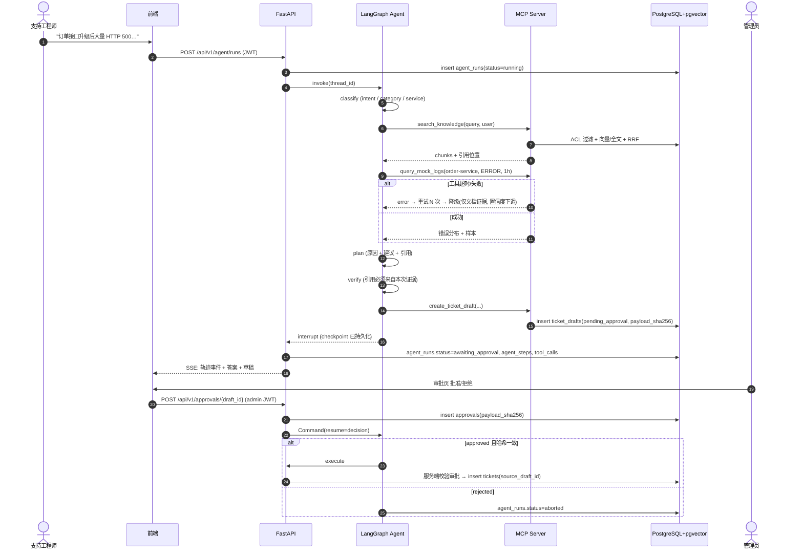

# OpsPilot AI 架构说明

## 1. 系统架构

```mermaid
flowchart LR
  subgraph Client["浏览器 (React + TS + Vite + Tailwind)"]
    UI[Dashboard / 聊天 / 知识库 / 工单 / 审批 / 轨迹 / 评测]
  end

  subgraph API["FastAPI 后端 (backend/src/opspilot)"]
    MW[中间件: request_id · 结构化日志 · CORS · 统一错误]
    AUTH[JWT 认证 + 角色/ACL 依赖]
    R[API 路由层 api/routes]
    S[Service 层 services]
    REPO[Repository 层 repositories]
    AG[LangGraph Agent\nStateGraph + Checkpointer]
    RET[检索服务\n向量 · 全文 · RRF · Reranker]
    LLMI[LLM / Embedding Provider 接口]
  end

  subgraph Tools["MCP Server (Python SDK, 独立进程)"]
    T1[search_knowledge]
    T2[query_mock_logs]
    T3[get_ticket]
    T4[create_ticket_draft]
  end

  subgraph Data["PostgreSQL 17 + pgvector"]
    PG[(业务表 · chunks.embedding vector(1024) · tsvector)]
    CP[(LangGraph checkpoints)]
  end

  MOCK[[MockLLM / MockEmbedding\n离线·确定性]]
  QWEN[[Qwen (DashScope OpenAI 兼容)]]
  LOGS[[模拟日志数据集]]

  UI -- REST / SSE --> MW --> AUTH --> R --> S --> REPO --> PG
  S --> AG
  AG --> RET --> PG
  AG -- MCP stdio/HTTP --> Tools
  T1 --> RET
  T2 --> LOGS
  T3 --> PG
  T4 --> PG
  AG --> CP
  AG --> LLMI
  LLMI --> MOCK
  LLMI -.可配置.-> QWEN
```

阶段 1 已落地：中间件、统一错误、JWT 认证与角色依赖、API/Service/Repository 分层骨架、LLM/Embedding 接口（Mock + OpenAI 兼容实现）、完整数据库迁移、健康检查、最小前端。其余组件为设计，按阶段实现。

## 2. 核心数据流：故障分析 + 人工审批



**关键约束**：`tickets` 的写入只发生在审批服务中，且该服务在同一事务内校验 `approvals.decision='approved'` 与 `approvals.payload_sha256 == ticket_drafts.payload_sha256`；模型或 MCP 工具都**没有**直接写 `tickets` 的路径（`tickets.source_draft_id UNIQUE` 保证同一草稿只能执行一次）。

## 3. 分层

| 层 | 目录 | 职责 | 依赖规则 |
|---|---|---|---|
| API | `api/routes`, `api/schemas.py`, `api/deps.py` | HTTP、校验、认证依赖、响应模型 | 只调 Service |
| Service | `services/` | 业务规则、事务边界、编排 | 调 Repository、Provider |
| Repository | `repositories/` | SQLAlchemy 查询，无业务规则 | 只依赖 `db/` |
| Domain/DB | `db/models.py`, `db/session.py` | ORM 模型、引擎、会话 | — |
| Provider | `llm/` | LLM/Embedding 抽象与实现 | 不依赖 Web/DB |
| Core | `core/` | 配置、日志、错误、安全 | 被所有层使用 |

配置只在 `core/config.py`（pydantic-settings, `OPSPILOT_` 前缀）读取；业务代码不直接读环境变量。

## 4. 关键技术决策（ADR 摘要）

| # | 决策 | 理由 |
|---|---|---|
| ADR-01 | **PostgreSQL + pgvector** 同时存业务数据、向量、全文索引 | 一个库内完成 ACL 过滤 + 向量 + 关键词检索，事务一致；部署简单（WSL2 一个容器） |
| ADR-02 | 关键词检索用 PostgreSQL `tsvector`（`simple` 配置）作用于 `search_text` 列；中文在入库时由应用层分词后写入 `search_text` | 官方 PG 没有中文分词器；`simple` + 预分词避免安装 zhparser 等扩展，Docker 镜像保持官方 |
| ADR-03 | **同步** SQLAlchemy 2 + psycopg 3 | FastAPI 对同步路由使用线程池，阶段内并发需求低；同步 ORM 调试简单、与 Alembic 一致；LangGraph 的 Postgres Checkpointer 同样基于 psycopg 3。如果后续压测发现瓶颈，psycopg 3 可直接切 async 驱动 |
| ADR-04 | 向量维度固定 1024（`vector(1024)` + HNSW cosine） | 与 Qwen `text-embedding-v4` 默认维度一致；Mock Embedding 也输出 1024 维；配置校验禁止不一致的维度 |
| ADR-05 | Provider 抽象（`LLMProvider` / `EmbeddingProvider` Protocol） | Agent 不依赖厂商 SDK；测试与 CI 默认 Mock，零费用、确定性 |
| ADR-06 | Mock Embedding 用**特征哈希**而不是随机向量 | 共享词的文本余弦相似度更高，离线检索测试有意义 |
| ADR-07 | JWT（PyJWT, HS256）+ Argon2（pwdlib） | FastAPI 官方文档当前推荐 PyJWT + pwdlib；Argon2id 为 OWASP 推荐算法；拒绝 `alg=none` |
| ADR-08 | 健康检查分 `/health/live`（不碰依赖）与 `/health/ready`（DB、pgvector、迁移版本、LLM、Embedding，任一失败 503） | 符合容器编排探针语义；就绪检查**不调用付费模型**，只做配置校验 |
| ADR-09 | structlog JSON 日志 + 纯 ASGI 中间件注入 `request_id`，敏感字段自动打码 | 日志可被机器解析，可与 Agent 轨迹关联 |
| ADR-10 | 统一错误结构 `{"error":{code,message,request_id,details}}` | 前端与调用方只需处理一种格式 |
| ADR-11 | 审批状态在**服务端**由数据库约束 + 事务校验（见 §2） | 不依赖提示词约束副作用 |

## 5. 版本与选型依据（2026-11-02 在 PyPI / npm / Docker Hub 核对）

**阶段 1 已安装并验证**（见 `uv.lock`、`frontend/package-lock.json`）：

| 组件 | 版本 | 说明 |
|---|---|---|
| Python | 3.11.17（`requires-python >=3.11,<3.14`） | 满足 3.11+ 要求，LangGraph/MCP SDK 均支持 |
| FastAPI | 0.162.x | 当前最新 |
| Uvicorn[standard] | 0.54.x | |
| Pydantic / pydantic-settings | 2.14 / 2.16 | v2 API |
| SQLAlchemy | 2.1.6 | 2.x 声明式 `Mapped[]` 风格 |
| Alembic | 1.20.1 | |
| psycopg[binary] | 3.3.x | |
| pgvector (Python) | 0.5.1 | `pgvector.sqlalchemy.Vector` |
| PyJWT / pwdlib[argon2] | 2.15 / 0.3.1 | |
| structlog | 26.1 | |
| openai | 3.42 | 用于 OpenAI 兼容协议（Qwen），阶段 1 不发起调用 |
| pytest / ruff | 9.2 / 0.17.3 | |
| React / react-dom | 19.3.1 | |
| Vite / @vitejs/plugin-react | 8.3.5 / 6.1.2 | 需要 Node ≥ 20.19；jsdom 30 需要 Node ≥ 22.22，因此项目统一要求 **Node 22 LTS** |
| Tailwind CSS / @tailwindcss/vite | 4.3.3 | v4 用 Vite 插件，无需 PostCSS 配置 |
| TypeScript | **5.9.3**（未用 7.0） | 7.0 为原生（Go）编译器的新大版本，生态插件兼容性仍在变化；5.9 为稳定线 |
| Vitest / jsdom / Testing Library | 5.0.5 / 30.1.3 / 16.3.3 | |
| PostgreSQL 镜像 | `pgvector/pgvector:0.8.7-pg17-trixie` | Docker Compose 与 CI 使用 |

**后续阶段计划使用**（已核对当前版本，阶段 3/4 安装时会重新核对官方文档）：`langgraph 1.2.x`、`langchain-core 1.7.x`、`langchain-openai 1.7.x`、`langgraph-checkpoint-postgres`、`mcp 2.3.x`（MCP Python SDK）。

## 6. 目录结构

```
backend/src/opspilot/   core/ db/ repositories/ services/ llm/ api/
backend/migrations/     Alembic（0001 初始全量 schema）
frontend/               React + TS + Vite + Tailwind
tests/unit|integration  pytest（集成测试连真实 PostgreSQL + pgvector）
evals/                  评测数据集与脚本（阶段 6）
scripts/                seed_demo.py、local_pg.sh
infra/                  docker-compose.yml、Dockerfile
docs/                   PRD / ARCHITECTURE / DATABASE / API / PROGRESS / reports
```
