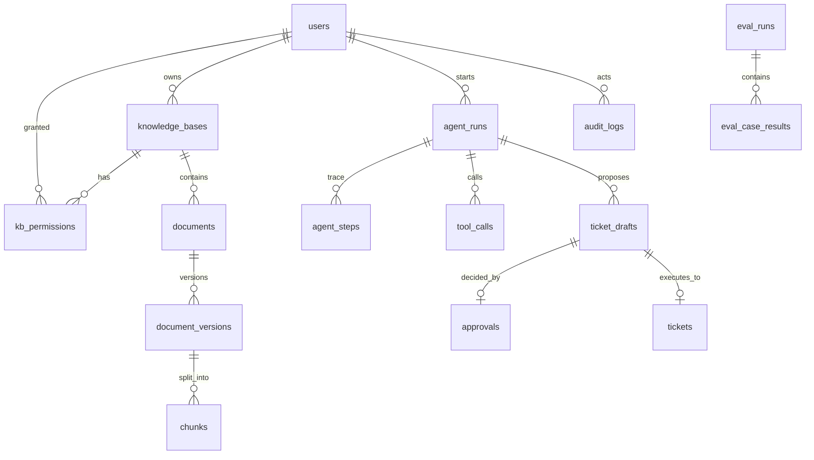

# 数据库设计

PostgreSQL（Compose 使用 17 + pgvector 0.8.7；本仓库阶段 1 在沙箱中实际验证的是 PostgreSQL 16.2 + pgvector 0.6.2，见报告）。
全部表由 Alembic 迁移 `0001` 一次创建（`backend/migrations/versions/20261102_0001_initial_schema.py`），模型定义在 `backend/src/opspilot/db/models.py`。主键统一 UUID（`audit_logs` 为自增 BIGINT）。约束命名遵循统一 naming convention，方便迁移与错误定位。

## ER 概览



## 表说明

### 身份与权限
| 表 | 主要列 | 约束 / 索引 | 用途 |
|---|---|---|---|
| `users` | email, display_name, password_hash(Argon2id), role, is_active, last_login_at | `uq(email)`；`ck role IN (user,admin)` | 账号与系统角色 |
| `knowledge_bases` | slug, name, description, visibility, owner_id | `uq(slug)`；`ck visibility IN (private,restricted,public)` | 知识库 |
| `kb_permissions` | kb_id, user_id, permission(read/write/admin), granted_by | `uq(kb_id,user_id)`；`ix(user_id)` | 知识库 ACL |

**ACL 规则**（阶段 2 实现于 Repository 的 SQL WHERE 中）：`admin` 可见全部；`public` 对所有登录用户可读；`restricted/private` 需 `kb_permissions` 中存在记录（private 仅 owner + 明确授权）。

### 知识
| 表 | 主要列 | 约束 / 索引 | 用途 |
|---|---|---|---|
| `documents` | kb_id, source_name, title, mime_type, status(active/deleted), current_version, uploaded_by | `uq(kb_id, source_name)`；`ix(kb_id)` | 逻辑文档 |
| `document_versions` | document_id, version, content_sha256, size_bytes, storage_path, index_status(pending/indexing/indexed/failed), error_message, chunk_count, embedding_model | `uq(document_id, version)`；`ix(content_sha256)` | 每次上传一个版本；哈希去重 |
| `chunks` | kb_id, document_id, document_version_id, chunk_index, content, search_text, **tsv**, **embedding vector(1024)**, page_number, heading_path, char_start, char_end, token_count, is_active | `uq(document_version_id, chunk_index)`；`ix(kb_id,is_active)`；**GIN(tsv)**；**HNSW(embedding vector_cosine_ops, m=16, ef_construction=64)** | 检索单元 |

- `tsv` 是生成列：`to_tsvector('simple', search_text)` STORED。`search_text` 由应用写入（中文先分词，以空格连接），见 ARCHITECTURE ADR-02。
- 可定位位置 = `document.source_name` + `version` + `page_number` / `heading_path` + `char_start..char_end`，引用即由这些列拼成。
- 新版本入库成功后，旧版本 chunks `is_active=false`（检索只查 active），实现"文档版本变化"而不丢历史引用。
- `embedding` 为 NOT NULL：只有 Embedding 成功的分块才写入，避免半索引状态。

### 工单与审批
| 表 | 主要列 | 约束 / 索引 | 用途 |
|---|---|---|---|
| `ticket_drafts` | run_id, action(create/update), target_ticket_id, title, description, category, priority, service, evidence(JSONB), payload_sha256, status, created_by | `ck status IN (pending_approval,approved,rejected,executed,expired)`；`ix(status, created_at)` | Agent/MCP 只能写到这里 |
| `approvals` | draft_id, decision, reviewer_id, comment, payload_sha256, decided_at | `uq(draft_id)`（一个草稿只能被决策一次） | 人工审批记录 |
| `tickets` | number, title, description, category, priority(P1–P4), status, service, reporter_id, assignee_id, **source_draft_id**, tags, resolution | `uq(number)`；**`uq(source_draft_id)`**（同一草稿只能落地一次）；`ix(status, created_at)` | 正式工单 |

`tickets ↔ ticket_drafts` 互相引用：`ticket_drafts.target_ticket_id` 的外键在迁移中于两表创建后单独 `ALTER TABLE` 添加。

### Agent 轨迹
| 表 | 主要列 | 约束 / 索引 |
|---|---|---|
| `agent_runs` | thread_id（= LangGraph checkpoint thread）, user_id, input_text, intent, category, status(running/awaiting_approval/completed/aborted/failed), final_answer, citations(JSONB), confidence, llm_provider, llm_model, step_count, prompt_tokens, completion_tokens, latency_ms, error, finished_at | `uq(thread_id)`；`ix(user_id, created_at)` |
| `agent_steps` | run_id, seq, node, status(ok/error/skipped/fallback), input_summary, output_summary, tokens, started_at, duration_ms, error | `uq(run_id, seq)` |
| `tool_calls` | run_id, step_id, tool_name, transport(inprocess/mcp), arguments, result, status(ok/error/timeout/denied/fallback), attempt, error, duration_ms, caller_id | `ix(run_id)`；`ix(tool_name, created_at)` |

LangGraph 自身的 checkpoint 表由 `langgraph-checkpoint-postgres` 的 `setup()` 在阶段 4 创建（不由本迁移管理，避免与库内部 schema 版本冲突）。

### 评测与审计
| 表 | 主要列 |
|---|---|
| `eval_runs` | name, dataset_name, dataset_sha256, retriever(basic/hybrid…), llm_provider, git_commit, config, metrics(JSONB), status, started_at, finished_at |
| `eval_case_results` | eval_run_id, case_id, **label_source(human/synthetic)**, agent_run_id, recall_at_5, task_completed, grounded, tool_success_rate, latency_ms, total_tokens, details；`uq(eval_run_id, case_id)` |
| `audit_logs` | actor_id, action, resource_type, resource_id, request_id, details；`ix(actor_id, created_at)`、`ix(resource_type, resource_id)` |

## 迁移操作

```bash
uv run alembic upgrade head      # 创建扩展 vector + 全部表
uv run alembic downgrade base    # 全部回滚（含 DROP EXTENSION vector）
uv run alembic check             # 校验模型与迁移一致（阶段 1 结果：No new upgrade operations detected.）
```
